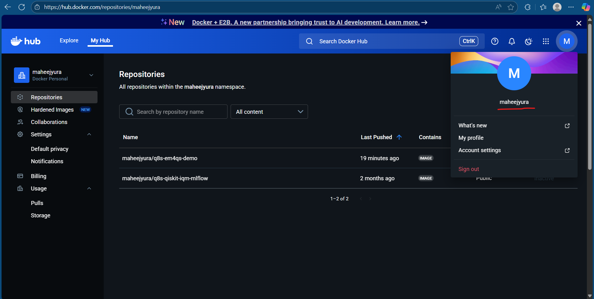

# Q8S Tenant Sample Project

This is a sample project demonstrating how to run quantum computing workloads using Q8S (Quantum on Kubernetes) with mlflow logging.

## Overview

This project includes:
- **`Q8Sproject`**: Project configuration file for Q8S
- **`app.py`**: Basic quantum circuit example using Qiskit and Aer simulator
- **`app_mlflow.py`**: Quantum circuit with MLflow experiment tracking
- **`.env.q8s`**: Environment variables for execution.


## Prerequisites

- Python 3.10 or higher
- `pip` package manager
- Docker (installed in the computer)
- Docker Hub account
- Q8S tenant kubeconfig file

## Setup Instructions

### 1. Install Q8S Library

Install the Q8S Python library:

```bash
pip install q8s
```

### 2. Configure Kubeconfig

1. Place your tenant kubeconfig file in your computer
2. Open the `Q8Sproject` file
3. Update the `kubeconfig` field with the path to your kubeconfig file:
   ```yaml
   kubeconfig: /path/to/your-tenant-kubeconfig.yaml
   ```

### 3. Configure Docker Hub

1. Go to [hub.docker.com](https://hub.docker.com) and sign in (or sign up if you don't have an account)
2. After signing in, click on your user profile icon in the top right corner
3. Copy your username from the dropdown menu
   
   

4. Open the `Q8Sproject` file and paste your username:
   ```yaml
   docker:
     username: your_dockerhub_username
   ```

❗**IMPORTANT:** Make sure you have signed in to your local Docker application with the same account you used for Docker Hub.

### 4. Build the Project

Initialize and build your Q8S project:

```bash
q8sctl build --init
```

❗**IMPORTANT:** Make sure Docker is already running on your computer when you run the above command.

This command will:
- Create a Docker container with your Python environment
- Install all dependencies specified in `Q8Sproject` to the container
- Push the container to Docker Hub

### 5. Execute Your Application

Run the sample quantum circuit:

```bash
q8sctl execute app.py
```

### 6. Integrating MLflow Logging

1. Update the environment variable in the `.env.q8s` file:
   ```bash
   export MLFLOW_TRACKING_URI="http://mlflow-service.tenant-<your_tenant_name>:5000"
   ```
   Replace `<tenant_name>` with your tenant name.  
   Example: `export MLFLOW_TRACKING_URI="http://mlflow-service.tenant-abc:5000"`

2. Execute the `app_mlflow.py` file using the `q8sctl execute` command:
   ```bash
   q8sctl execute app_mlflow.py
   ```

3. Visit the following URL to access MLflow:
   ```
   https://mlflow.tenant-<your_tenant_name>.em4qs.qubernetes.dev/
   ```
   Replace `<your_tenant_name>` with your tenant name.  
   Example: `https://mlflow.tenant-abc.em4qs.qubernetes.dev/`

4. Your logged data will be visible in the **Experiments** section under the `sample-experiment` experiment.
